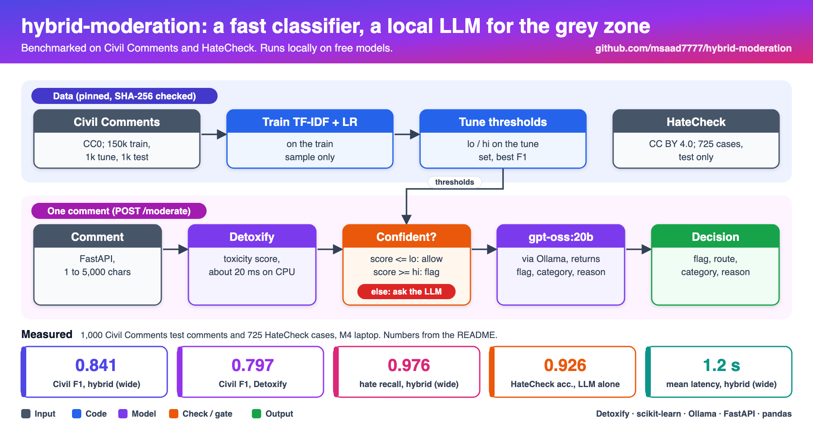

# hybrid-moderation

A comment moderator that sends each comment to a fast classifier first and only asks a local LLM about the
grey zone. It's measured against five single systems on two public benchmarks. Everything runs on a laptop
with free models and no API key.



## Results at a glance

1,000 held-out Civil Comments (30% toxic) and 725 HateCheck test cases. Apple M4 laptop, CPU for the classifiers,
Ollama for the LLMs. Every number comes from `results/results.json`.

| System | Civil F1 | Civil precision / recall | HateCheck hate recall | HateCheck accuracy | Mean latency |
|---|---|---|---|---|---|
| Word list + threat regex | 0.150 | 0.758 / 0.083 | 0.093 | 0.314 | 0.1 ms |
| TF-IDF + logistic regression | 0.763 | 0.875 / 0.677 | 0.642 | 0.631 | 0.6 ms |
| Detoxify (`unbiased`) | 0.797 | 0.903 / 0.713 | 0.773 | 0.705 | 20.6 ms |
| gpt-oss:20b alone | 0.653 | 0.663 / 0.643 | **0.996** | **0.926** | 5,415 ms |
| qwen3:8b alone | 0.592 | 0.660 / 0.537 | **0.996** | 0.905 | 8,562 ms |
| Detoxify, threshold tuned | 0.833 | 0.851 / 0.817 | 0.844 | 0.732 | 20.6 ms |
| **Hybrid, best F1** (Detoxify + gpt-oss) | 0.835 | 0.854 / 0.817 | 0.847 | 0.738 | 68 ms |
| **Hybrid, wide** (Detoxify + gpt-oss) | **0.841** | 0.764 / **0.937** | 0.976 | 0.822 | 1,243 ms |

The honest summary:

- **Tuned for F1 alone, the hybrid barely uses the LLM.** It sends 0.8% of Civil Comments to gpt-oss, and its
  F1 (0.835) is within noise of Detoxify with a re-tuned threshold (0.833). Most of the gain over plain
  Detoxify (0.797) comes from the threshold, not the LLM.
- **Sending 20% to the LLM is where it pays off.** Toxic-comment recall goes from 0.817 to 0.937 and HateCheck
  hate recall from 0.844 to 0.976, for a mean latency of 1.2 s instead of 21 ms. The p95 is 7.1 s.
- **On HateCheck the LLM alone beats every classifier** (accuracy 0.926 vs 0.705), but on Civil Comments only
  the word list does worse (gpt-oss F1 0.653). Civil Comments' crowd labels and the written policy the LLM
  follows disagree on many comments. The LLM follows the policy you write, not the labels you happen to have.
- **The LLM answer always parsed.** 4,450 calls across both models, 0 schema failures.

## Architecture

1. **Data.** `scripts/get-data.sh` downloads three public datasets at pinned revisions and checks their SHA-256.
   `data.py` builds deterministic samples: 150,000 Civil Comments for training (20% toxic), 1,000 for tuning
   and 1,000 for testing (30% toxic each, from the official validation and test splits). It also takes up to
   25 HateCheck cases from each of its 29 functionalities.
2. **Single moderators** (`moderators.py`), each returning a score, a flag and its latency:
   - a word list (LDNOOBW) with whole-word matching, plus a direct-threat regex;
   - TF-IDF on word 1–2-grams and character 3–5-grams, with logistic regression, trained on the 150k sample;
   - Detoxify `unbiased`, a RoBERTa model trained to reduce identity bias;
   - a local LLM through Ollama's `/api/chat`, given a written policy and a JSON schema for the answer
     (`flag`, `category`, `reason`), at temperature 0.
3. **Hybrid** (`evaluate.hybrid`, `pipeline.Hybrid`). The classifier scores every comment. A score at or below
   `lo` is allowed, a score at or above `hi` is flagged, and anything in between goes to the LLM.
4. **Tuning** (`evaluate.tune`). `lo` and `hi` are grid-searched over 101 quantiles of the classifier's score,
   **on the tune set only**, for the best F1 with at most 25% of comments sent to the LLM. The "wide" profile
   adds a floor of 20%. The test sets are never used to choose anything.
5. **Service** (`pipeline.py`). FastAPI with `POST /moderate` and `GET /healthz`. The response says which route
   decided (`ml` or `llm`), so every decision can be audited.

```
$ curl -s localhost:8000/moderate -H 'content-type: application/json' \
    -d '{"text": "Go back to where you came from, nobody wants your kind here."}'
{"flag": true, "route": "llm", "ml_score": 0.314, "ms": 3510.9, "category": "hate",
 "reason": "The comment contains hateful language aimed at a group, demeaning and dehumanising them."}
```

That run used `MODERATION_PROFILE=wide`. With the default thresholds, Detoxify's 0.314 is below `lo`, so the
comment would have been allowed without asking the LLM.

## Data and licences

| Dataset | Licence | Used for | Pinned revision |
|---|---|---|---|
| [Civil Comments](https://huggingface.co/datasets/google/civil_comments) | CC0 1.0 | train, tune, test | `f2970eb3` |
| [HateCheck](https://huggingface.co/datasets/Paul/hatecheck) (Röttger et al., ACL 2021) | CC BY 4.0 | test only | `9d2ac89d` |
| [LDNOOBW English list](https://github.com/LDNOOBW/List-of-Dirty-Naughty-Obscene-and-Otherwise-Bad-Words) | CC BY 4.0 | the word-list baseline | `5faf2ba4` |

A Civil Comments comment counts as toxic when its `toxicity` score is at least 0.5, the dataset's own convention.
The raw data isn't in this repo. The cached scores in `results/scores/` hold row numbers, scores and the LLM's
short reasons, not the comments.

Models, all run locally: Detoxify (Apache 2.0), gpt-oss:20b (Apache 2.0) and qwen3:8b (Apache 2.0).

## How HateCheck is scored

HateCheck tests behaviours, not averages. The hateful cases give **hate recall**. The non-hateful cases are split
by what they test, because a moderator can be wrong in different ways:

| Group | Functionalities | Detoxify | gpt-oss | Hybrid, wide |
|---|---|---|---|---|
| Identity mentioned neutrally or positively | `ident_neutral_nh`, `ident_pos_nh` | 0.02 | 0.00 | 0.08 |
| Counter-speech: quoting or denouncing hate | `counter_quote_nh`, `counter_ref_nh` | 0.74 | 0.52 | 0.90 |
| Other non-hate: negation, reclaimed slurs, homonyms, objects | 4 functionalities | 0.52 | 0.20 | 0.56 |
| Policy grey: profanity or abuse not aimed at a protected group | `profanity_nh`, `target_indiv_nh`, `target_group_nh` | 0.81 | 0.55 | 0.87 |

The first three rows are false-positive rates, so lower is better. The policy-grey row is a flag rate, not an
error rate: a toxicity policy may rightly flag a sworn insult at a person even though it isn't hate. Those cases
are left out of the accuracy number.

## Design decisions

- **Classifier first, LLM second.** The classifier answers in about 20 ms and the LLM in 3–11 s. Sending only
  uncertain comments to the LLM keeps the mean at 1.2 s even in the wide profile.
- **Thresholds chosen on a separate tune set.** Choosing them on the test set would have inflated every hybrid
  number.
- **A cap and a floor on the LLM share.** Without a floor, F1 tuning picked a band so narrow the LLM barely ran
  (see "What failed").
- **A JSON schema instead of parsing free text.** Ollama constrains the output to the schema. If an answer still
  fails to parse, the comment is **not** flagged and the raw answer is kept in the result, rather than guessed.
- **The route is part of the API response.** Moderation decisions get appealed, so you need to know what decided.
- **Detoxify is an optional extra.** It pulls in PyTorch, so CI installs without it and the tests use fakes.

## What failed during the build

- **F1 tuning made the LLM almost useless.** The first hybrid looked like a clear win (0.835 vs 0.797) until
  the ablation showed that Detoxify with a tuned threshold gets 0.833. The tuner sent 1% of comments to the LLM
  because, scored against Civil Comments labels, the LLM does worse than the classifier. The fix was to report
  the LLM share and the ablation next to every hybrid number, and to add the wide profile.
- **The wide hybrid makes counter-speech worse** (false positives 0.74 → 0.90). Its band covers *low* Detoxify
  scores, so the LLM catches hate that Detoxify missed. Counter-speech scores *high* on Detoxify, so it's flagged
  before the LLM ever sees it, and the tuned `hi` (0.36) is below Detoxify's default 0.5. Fixing that needs an
  LLM review of high scores as well, which means more LLM calls.
- **TF-IDF learned identity bias.** It flags 40% of neutral or positive identity mentions ("I'm a proud
  Muslim"). Detoxify, trained against that bias, flags 2%.
- **The first LLM run was too slow.** At about 4.7 s a comment, 3,000 comments per model would have taken most
  of a day. Setting Ollama's `num_ctx` to 4096 brought gpt-oss to about 3.9 s in a short check. qwen3:8b then ran
  only on the two test sets, not the tune set, so there's no qwen3 hybrid.
- **qwen3:8b was slower than gpt-oss:20b** (8.6 s vs 5.4 s mean on Civil Comments) with thinking turned off,
  and no more accurate.

## Limitations

- English only, and samples rather than full datasets: 1,000 Civil Comments test comments and 725 HateCheck
  cases. Differences of a point or two in F1 are within sampling noise.
- One policy and one prompt. A different written policy would move the LLM's numbers, which is the point of
  having one, but these numbers describe this policy.
- HateCheck cases are short template sentences. They test specific behaviours, not real-world traffic.
- Latency was measured on one M4 laptop doing nothing else. It isn't a throughput benchmark.

## How to run

Needs [uv](https://docs.astral.sh/uv/) and, for the LLM, [Ollama](https://ollama.com) with
`ollama pull gpt-oss:20b`.

```bash
uv sync --extra models                                   # Detoxify pulls in PyTorch
./scripts/get-data.sh                                    # about 225 MB, checked against SHA-256
uv run python -m hybrid_moderation.evaluate prepare      # build the sets, train TF-IDF
uv run python -m hybrid_moderation.evaluate score rules,tfidf_lr,detoxify
uv run python -m hybrid_moderation.evaluate score llm_gpt-oss   # hours: about 4-5 s per comment
uv run python -m hybrid_moderation.evaluate report       # tunes the hybrid, writes results/results.json
```

Scores are cached per comment in `results/scores/`, so an interrupted LLM run resumes where it stopped.

Run the service on the committed thresholds:

```bash
uv run uvicorn hybrid_moderation.pipeline:app --port 8000                          # best-F1 profile
MODERATION_PROFILE=wide uv run uvicorn hybrid_moderation.pipeline:app --port 8000  # 20-25% to the LLM
```

The tests need no models, no Ollama and no data: `uv run pytest -q`.

## Project layout

```
scripts/get-data.sh                    pinned downloads with SHA-256 checks
src/hybrid_moderation/data.py          deterministic train, tune and test samples
src/hybrid_moderation/moderators.py    word list, TF-IDF, Detoxify, LLM
src/hybrid_moderation/evaluate.py      scoring, caching, tuning, metrics, report
src/hybrid_moderation/pipeline.py      the hybrid as a FastAPI service
results/results.json                   every number in this README
docs/architecture.svg                  the diagram above
```

## Licence

MIT.
